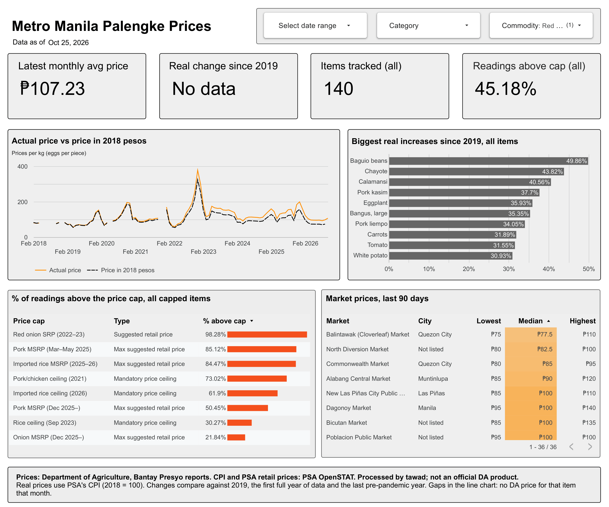
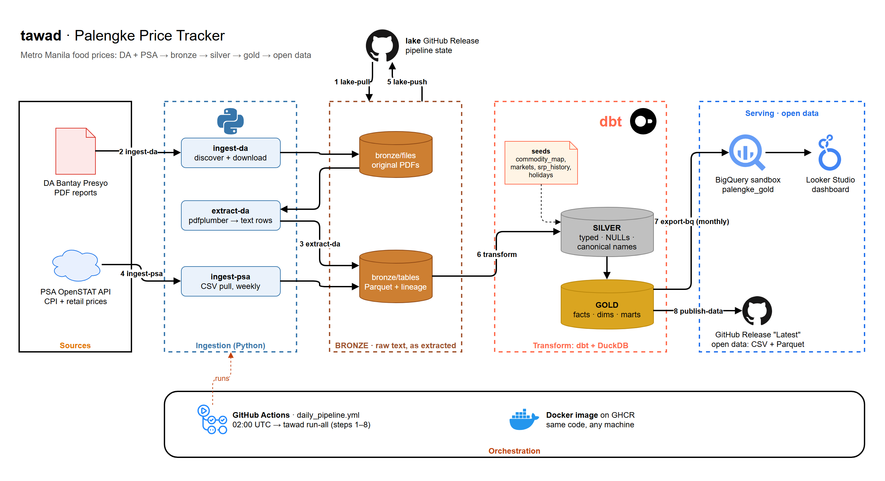
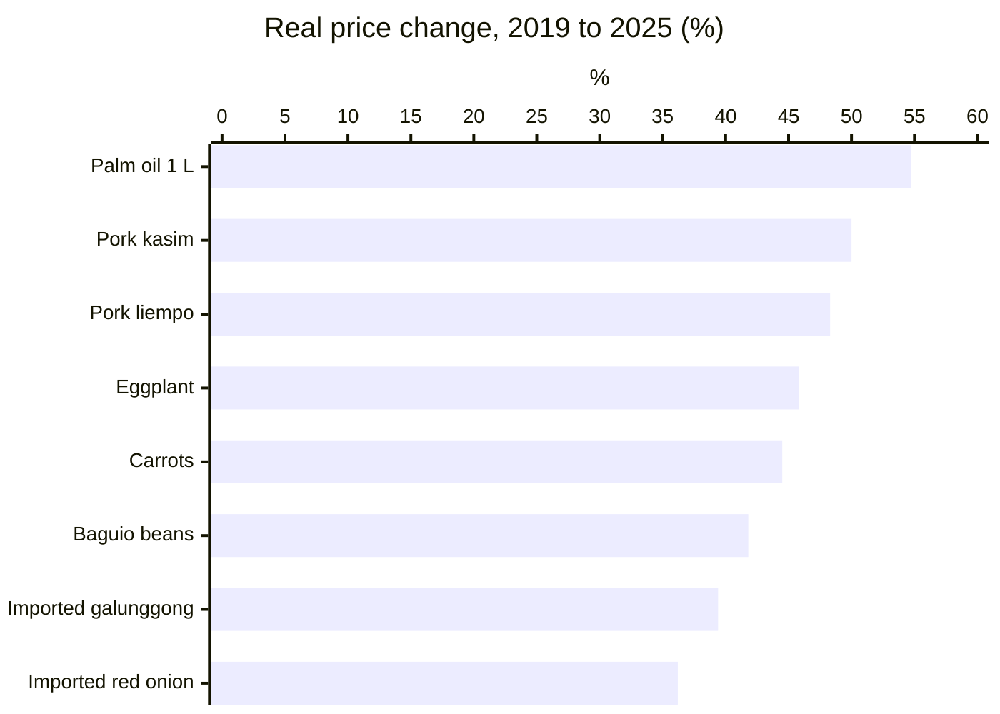
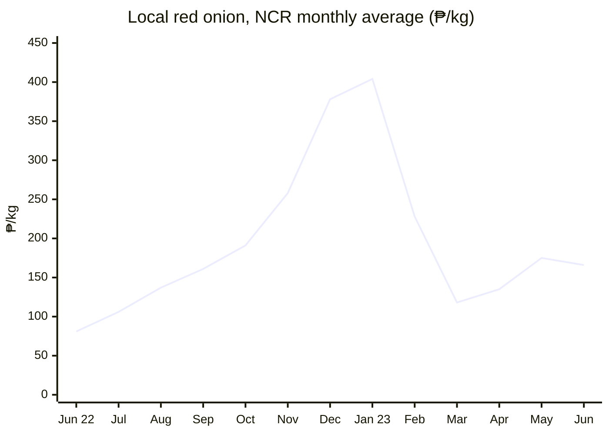
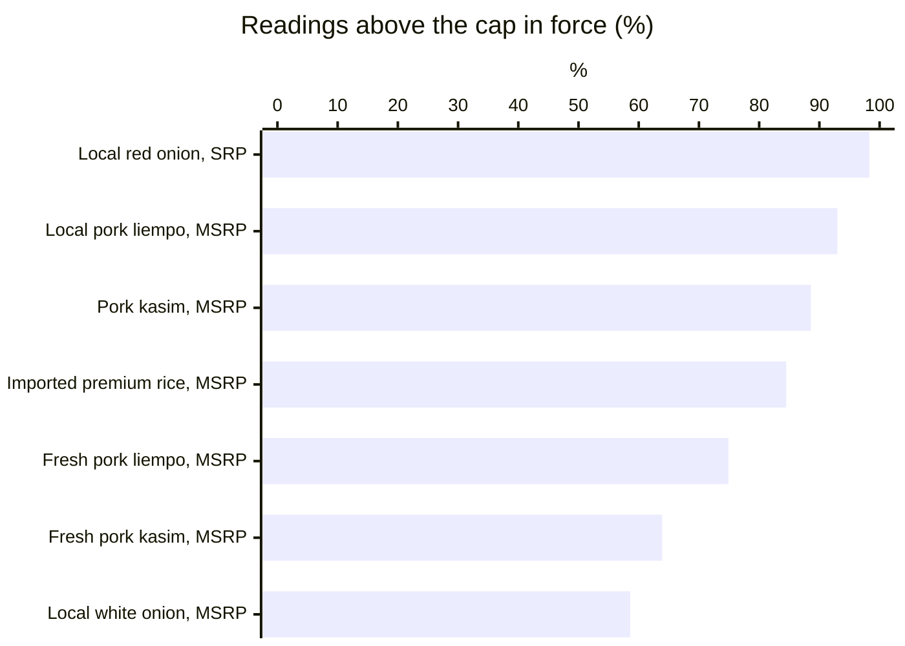
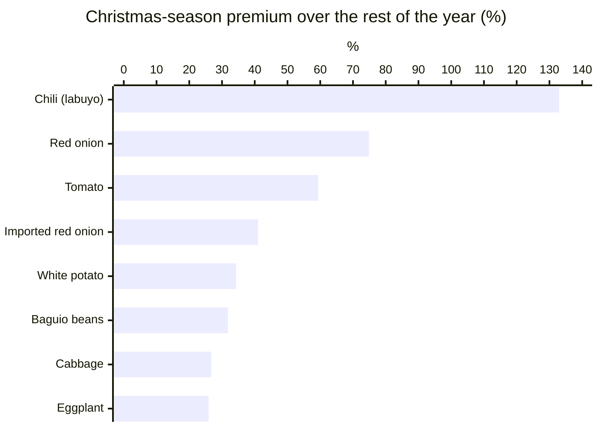
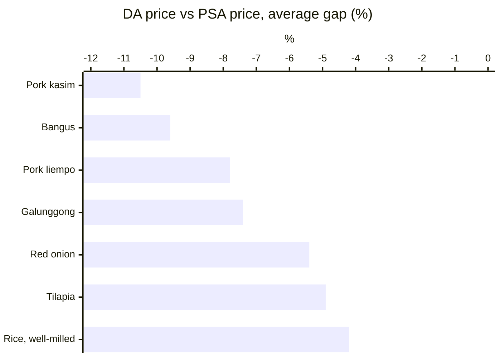

# Palengke Price Tracker (tawad)

[](https://github.com/OrcaDS/tawad/actions/workflows/ci.yml)
[](https://github.com/OrcaDS/tawad/actions/workflows/daily_pipeline.yml)
[](https://github.com/OrcaDS/tawad/pkgs/container/tawad-pipeline)

The Department of Agriculture (DA) has published Metro Manila palengke (wet market) prices almost every day since 2018, but only as PDFs, in at least five changing layouts, with typos and many ways of writing "no price". tawad turns about 2,900 of those reports into one clean, daily-updated table of roughly 890,000 prices (Feb 2018 to today, 55 markets), adds PSA inflation and retail data, and publishes the result as free open data, a BigQuery dataset and a Looker Studio dashboard. Anyone can now answer questions like "did pork outpace inflation?" or "how often were prices above the government cap?" without retyping a PDF.

**[Open the dashboard](https://datastudio.google.com/reporting/c47a145d-92d6-47c1-9d71-34a46927e509)** · **[Download the data](../../releases/latest)** · [Data dictionary](docs/data_dictionary.md)



## Architecture



A medallion pipeline. **Bronze** keeps the text exactly as it came out of each PDF or API, with its source file and page. **Silver** (dbt) types it, turns every missing-price token into NULL, and maps DA's names onto canonical commodities and markets. **Gold** is a star schema (`fct_prices`, `dim_commodity`, `dim_location`, `dim_date`) plus marts for real prices, price caps and DA vs PSA. GitHub Actions runs the whole thing every day inside the published Docker image; the only state between runs is a GitHub Release holding the lake.

## Findings

All numbers come from the [example queries](warehouse/queries/) on the gold tables (DA's NCR-wide prices unless noted; flagged outliers excluded).

### 1. Pork, cooking oil and vegetables beat inflation by 40–55% since 2019

After removing general inflation (PSA's NCR consumer price index, 2018 = 100), palm cooking oil cost 55% more in 2025 than in 2019, pork kasim 50% more, and pork liempo 48% more. These are *real* increases: on top of what everything else rose. ([`real_price_change.sql`](warehouse/queries/real_price_change.sql))



### 2. The 2022–23 onion crisis: local red onion went from ₱81 to ₱404 a kilo in seven months

DA's NCR average for local red onion rose every month from June 2022 to a peak of ₱404/kg in January 2023, five times its mid-2022 price, then fell back to ₱118 by March 2023.



### 3. Price caps are often not what shoppers pay

Each price is checked against the cap in force that day (suggested retail price, maximum suggested retail price or mandatory ceiling, matched by grade and cut; sources in [`srp_history.csv`](transform/seeds/srp_history.csv)). During the onion SRP, 98% of local red onion readings were above it, by ₱201 on average. Fresh pork liempo was above its 2025 MSRP in 75% of 8,000 market readings. ([`srp_compliance.sql`](warehouse/queries/srp_compliance.sql))



### 4. Christmas is expensive for siling labuyo, onions and tomatoes

Comparing each year's Christmas season (1 Dec to 6 Jan) with the rest of that year: chili (labuyo) averaged 133% more, red onion 75% more and tomato 59% more, over 5–8 seasons each. ([`christmas_effect.sql`](warehouse/queries/christmas_effect.sql))



### 5. DA and PSA mostly agree, and DA reads a little cheaper on meat and fish

Over eight years of monthly NCR averages, DA's prices for rice, onion and tilapia sit within 6% of PSA's. For pork, bangus and galunggong DA is consistently 7–11% lower. The two agencies collect differently (DA reports one prevailing price per market), so the gap is a method difference to keep in mind, not an error in either. ([`da_vs_psa.sql`](warehouse/queries/da_vs_psa.sql))



## Get the data

The [latest GitHub Release](../../releases/latest) holds every gold table as Parquet and as CSV (one zip), with [`data_dictionary.md`](docs/data_dictionary.md). It updates whenever the data changes.

- **Attribution:** Source: Department of Agriculture Bantay Presyo reports. Cleaned and standardized by tawad. Not an official DA product.
- **Disclaimer:** provided as is. DA's own typos are kept and flagged (`is_outlier`), never fixed, and parsing may contain errors.
- **Licenses:** code is [MIT](LICENSE). DA-derived tables are Philippine government data, which has no copyright (RA 8293 §176); commercial users should check with DA. PSA data is under PSA's terms of use.

## Data sources

- **Department of Agriculture**, Agribusiness and Marketing Assistance Service (DA-AMAS): Bantay Presyo daily price monitoring PDFs, 2018 onward. NCR-wide prevailing prices plus per-market prices for some years.
- **Philippine Statistics Authority** (PSA), OpenSTAT: NCR consumer price index (to convert prices to 2018 pesos) and monthly NCR retail prices (to cross-check DA).
- Government price caps (SRP, MSRP, ceilings): hand-collected from DA advisories and executive orders, each row with its legal basis and source link.

## Query it in BigQuery

Gold is loaded into a BigQuery sandbox dataset, `palengke_gold`. Example queries, each answering one question:

| Query | Question |
|---|---|
| [`real_price_change.sql`](warehouse/queries/real_price_change.sql) | Which foods got more expensive than inflation since 2019? |
| [`srp_compliance.sql`](warehouse/queries/srp_compliance.sql) | How often are prices above the government cap in force that day? |
| [`christmas_effect.sql`](warehouse/queries/christmas_effect.sql) | Do palengke prices rise in the Christmas season? |
| [`da_vs_psa.sql`](warehouse/queries/da_vs_psa.sql) | Do DA and PSA agree? |

The dashboard's own data sources are in [`warehouse/dashboard/`](warehouse/dashboard/). CI runs every one of these queries against a sample gold build, so they never drift from the schema.

## Engineering challenges

- **PDF format drift.** DA's reports span at least five layout eras (price watch, retail monitoring, price monitoring, daily index, weekly average), with continuation pages without titles, sheets split across two pages, stall-count pages that look like price tables, and digits the PDF spaces apart (`5 0.00`). Page type is read from the title line and header row, not the filename. Details in [`docs/parsing_notes.md`](docs/parsing_notes.md).
- **Missing values.** `n/a`, `-`, `#N/A`, `#DIV/0!`, `NONE`, `NOT AVAILABLE`, typos like `n/as`, and in older eras `0`: all become NULL through one `parse_price` macro whose unit test lists every raw shape. A missing price is never 0.
- **Report revisions.** DA replaces a report's link when it revises it, and sometimes uploads the same file under two dates. A manifest keeps every link ever seen; byte-identical duplicates are flagged instead of being extracted under the wrong date.
- **Name standardization.** About 1,500 distinct DA commodity spellings and 95 market names map through seed files to canonical names with variant and origin. A new, unmapped name fails a dbt test, so nothing slips in unmapped.
- **Units.** Units come from the commodity seed, not DA's unit column, so every series stays per kg (eggs per piece, oil per bottle).
- **Idempotent runs.** Bronze is partitioned by source file, so re-extracting a report overwrites exactly its rows. The daily run can be repeated or resumed safely.
- **No cloud credentials in CI.** Tests run dbt on a small committed sample of real bronze rows in DuckDB; only the daily run talks to BigQuery.
- **BigQuery sandbox limits.** The sandbox has a lifetime 10 GiB storage quota and 60-day table expiry. The loader reloads a table only when it changed and is at least four weeks old, or is about to expire, and keeps a running byte total.
- **Image-only PDFs.** 123 reports have no text layer. They're marked failed (`image_only`) in the manifest rather than silently dropped; OCR is future work.

## Design decisions

- **Medallion layers** keep the raw text separate from the cleaning. Every price can be traced back to its PDF and page (silver keeps both), and a parser fix is a re-extract, not a re-download.
- **DuckDB does the transformations; BigQuery only serves gold.** dbt on DuckDB is free, fast and runs identically on a laptop and in CI. BigQuery is there because Looker Studio reads it natively.
- **BigQuery sandbox** instead of a billed project: the project has to cost nothing to run. The sandbox's limits shape the loader (see above).
- **A GitHub Release as the data lake.** No credit card, versioned, public, and the daily runner only needs `gh`.

## Limitations

- DA covers Metro Manila only.
- Per-market DA prices exist only for some years and commodities; the NCR-wide series is the continuous one.
- Some DA prices are ranges (low–high), not single values.
- 123 image-only reports are not read yet (no OCR).
- DA's own typos stay in the data, flagged as outliers.

## Run it locally

With [uv](https://docs.astral.sh/uv/):

```sh
uv sync
uv run pytest -q
uv run tawad lake-pull           # restore bronze from the lake release
uv run tawad transform           # dbt build: silver + gold into lake/tawad.duckdb
uv run tawad run-all             # the full daily run
```

With Docker:

```sh
docker build -t tawad-pipeline .
docker run --rm --env-file .env -v "$PWD/lake:/app/lake" tawad-pipeline run-all
```

Settings come from environment variables, all listed in [`.env.example`](.env.example). Loading BigQuery needs `GCP_PROJECT_ID` and `GOOGLE_APPLICATION_CREDENTIALS` (a service account with BigQuery Job User on the project and Data Owner on the dataset).

## The daily run

[`daily_pipeline.yml`](.github/workflows/daily_pipeline.yml) runs `tawad run-all` in the published image every day at 10:00 Philippine time: pull the lake, download and extract new DA reports, pull PSA (weekly), push the lake, `dbt build`, load BigQuery (monthly), and publish a new open-data release if gold changed. If DA's site is down, that day's DA step is skipped and the rest still runs. It needs the repository secret `GCP_SA_KEY` and the variable `GCP_PROJECT_ID`.

GitHub turns off scheduled workflows in public repositories after 60 days without activity. If the data stops updating, re-enable the workflow under Actions.
